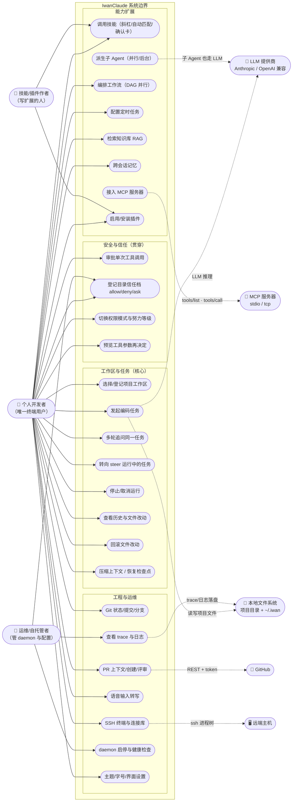

# 01 用例图 · 系统总览

**回答的问题**：这个系统对"谁"提供"什么价值"，边界外的参与者有哪些。

## 图

## 读图要点

1. **参与者只有三个真人角色**：终端用户、扩展作者、运维。其余都是外部系统（LLM、MCP、GitHub、SSH、本地文件系统）——这体现了"本地优先、外部只做推理与远端操作"的边界设计。
2. **多客户端是同一套用例**：GUI（Electron 桌面应用，窗口标题 `iwan work`）、TUI（`iwan-tui`）、CLI（`iwan`）共用同一条 JSON-RPC 命令表（68 个方法，见 `app.py:2421-2491`）。差异只在"暴露了多少用例"——见 [02 用例分解](02-用例图-用例分解与实现映射.md) 的客户端能力对照。
3. **安全不是独立用例，而是贯穿式的 include**：`A2 发起任务` 内部必然触发 `B1 审批` 或 `B2 信任豁免`，这也是为什么 [15 DFD 1 层](15-DFD-1层-进程内分解.md) 把权限评估画在工具执行的必经路径上。
4. **斜杠技能与自动匹配是同一用例的两个入口**：`C1` 的三种触发（显式 `skill_name`、`/name`、自动匹配确认）都在 `session/manager.py:336-454`。

## 代码锚点

- 命令表（用例 → RPC）：`src/iwan_claude/core/app.py:2421-2491`
- 会话内能力（技能/@文件/压缩/检查点）：`src/iwan_claude/core/session/manager.py`
- 引擎五选一：`src/iwan_claude/core/runner.py:1216-1299`（legacy / langgraph / plan_execute / debate / pipeline / auto）
- 定时与工作流装配：`src/iwan_claude/core/app.py:2341-2402`
