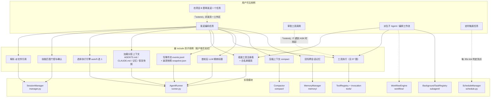
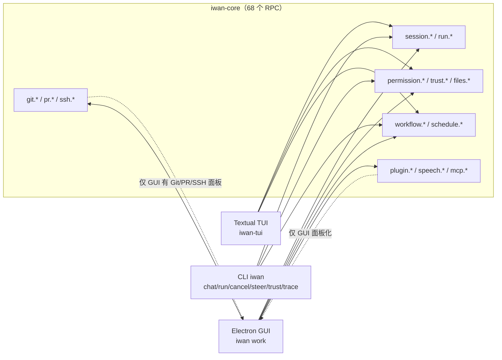

# 02 用例图 · 用例分解与实现映射

**回答的问题**：一个用例内部还包含哪些子用例（«include»/«extend»），以及它最终由哪个模块实现——这是"需求 → 代码"的落地地图。

## 图 A：核心用例分解

## 图 B：三个客户端各暴露哪些用例

## 客户端能力对照（按代码核对）

| 用例 | GUI | TUI | CLI |
|---|---|---|---|
| 发起任务 / 多轮对话 | ✅ Composer | ✅ ChatTextArea | ✅ `iwan chat` / `iwan run` |
| 多工作区（不同 cwd 的会话） | ✅ 侧栏"项目"分组 + 添加目录 | ⚠️ 多标签；点标签在忙碌时被挡（`tui/app.py:1135`），Alt+N 不受限——实现不一致 | ⚠️ 每次进程一个 cwd |
| 转向 / 停止 | ✅ 侧栏行内 + 停止钮 | ✅ Esc / 输入框 | ✅ `iwan cancel` / `iwan steer` |
| 审批工具 / 登记信任 | ✅ 卡片 | ✅ PermissionSelect / TrustCard | ✅ `iwan trust` |
| 技能确认卡 | ✅ SkillCard | ✅ SkillConfirm | ❌ |
| 工作流 | ✅ WorkflowView | ❌ 无视图（仅 RPC） | ❌ |
| 定时任务 | ✅ ScheduleView | ❌ | ❌ |
| PR / Git / SSH 面板 | ✅ | ❌ | ❌ |
| 插件 / MCP 面板 | ✅ PluginView | ❌ | ❌ |
| 语音输入 | ✅ 录音 + VAD 断句 | ❌ | ❌ |
| 文件回滚 | ✅ 右栏「变更」页签 | ✅ FileChanges | ❌ 无子命令（只能手写 `files.restore` RPC） |

> 结论：**GUI 是能力最全的客户端，TUI 是核心对话面**，CLI 只做脚本化与排障（与 `CLAUDE.md` 的产品定位一致）。

## 代码锚点

- 用例与 RPC 的一一对应：`src/iwan_claude/core/app.py:2421-2491`
- `@文件引用` / 技能三分支 / 标题精炼：`session/manager.py:394-544`
- 引擎 auto 选择：`runner.py:1218-1226`、`core/engine_selector.py`
- 上下文四层拼装：`runner.py:1063-1127`（global / project / CLAUDE.md / AGENTS.md / memory / recovery）
