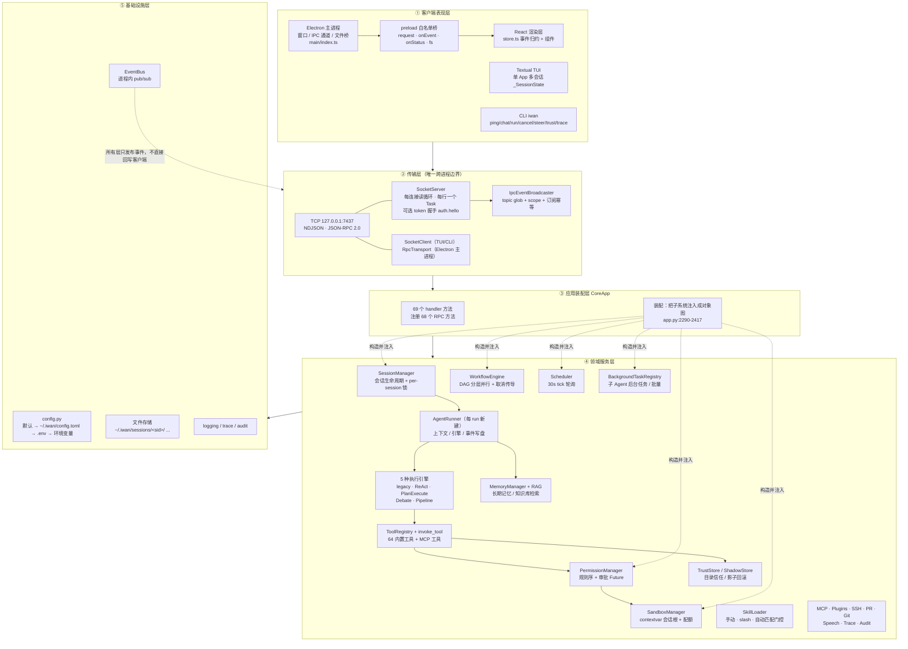

# 03 静态模型 · 分层架构与组件图

**回答的问题**：系统被切成哪几层、层与层的依赖方向、谁是唯一的跨进程边界。

## 图：组件与依赖

## 读图要点

1. **跨进程边界只有一条**：客户端永远不直接读 daemon 的内存。GUI 的"文件树 / 会话 meta / 配置 / RAG 评估"走 Electron 主进程直读磁盘（`fs-bridge.ts` 的 8 个 `ipcMain.handle`）——但那是**只读旁路**；业务数据与执行一律回 daemon，唯一例外是 GUI 自己的 `gui.json`（`settings:set`），因为 daemon 根本不知道它。
2. **依赖只向下**：`L4` 里没有任何模块 import `L3`；`WorkflowEngine`、`Scheduler` 甚至不 import `SessionManager`——它们只接收回调（`app.py:2344-2402` 注入），这是"可单测"的根本原因。
3. **EventBus 是全局横向通道**：任何层 `bus.publish(...)`，`EventWriter` 落盘、`IpcEventBroadcaster` 推客户端、`SnapshotWriter` 存崩溃快照——三者都是订阅者，互不知道彼此。
4. **装配层是全项目唯一"知道一切"的地方**：`CoreApp.run()` 里从配置 → 日志 → MCP → 记忆 → SessionManager → 调度 → 工作流 → SSH → SocketServer 手写装配（`app.py:2290-2417`），这是典型的 Composition Root 模式。

## 与"干净架构"的偏离（学习时值得注意）

- `session/manager.py` 在 `send_message` 里直接把 `set_sandbox_root(session.cwd)` 写进全局函数（`manager.py:322-324`）——用 ContextVar 兜住了并发，但"会话层知道沙箱层"仍是耦合。
- `AgentRunner` 每 run 新建并重新 `_build_registry`（`runner.py:616`），注册成本可接受，但意味着**工具注册表不是全局单例**，热加载语义要按 run 生效。

## 代码锚点

- 传输与广播：`core/transport/socket_server.py`、`core/transport/ipc_broadcaster.py`、`core/transport/socket_client.py`
- 装配与 handler：`core/app.py:2290-2491`
- 引擎选择：`core/runner.py:1216-1299`
- 客户端分层：`gui/src/main/index.ts`、`gui/src/preload/index.ts`、`gui/src/renderer/src/store.ts`
