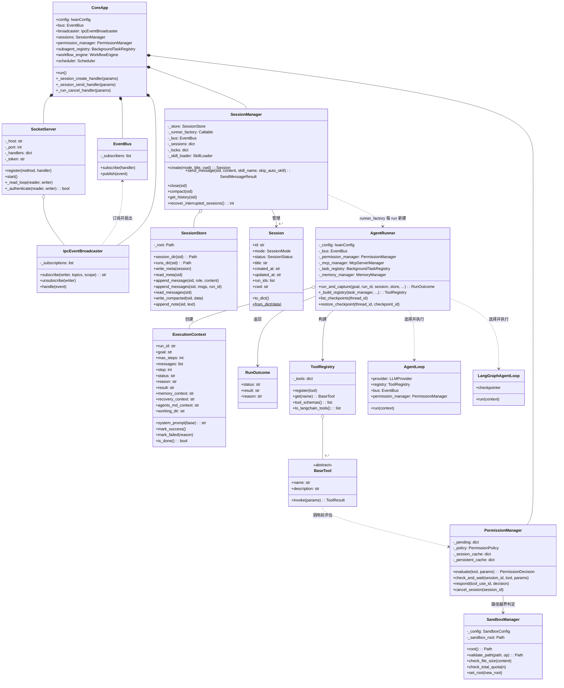
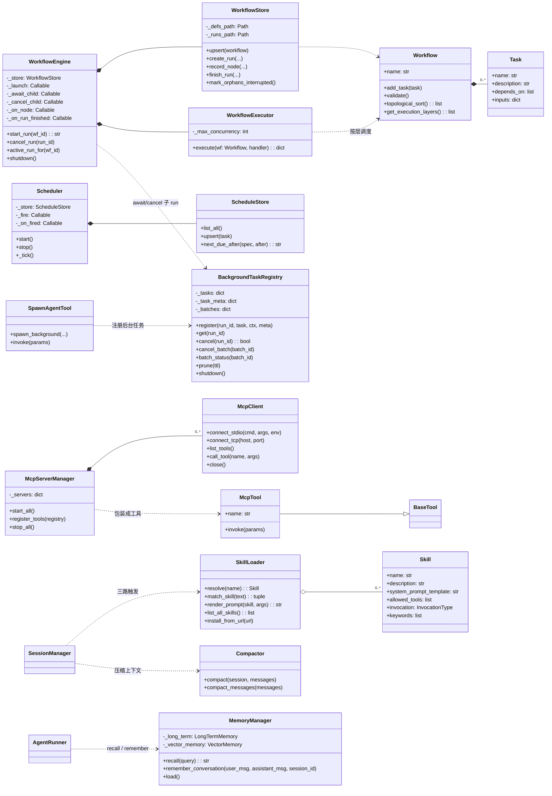

# 04 静态模型 · 类图（核心域）

**回答的问题**：一次任务从"会话"到"引擎"到"工具"，对象是怎么持有、怎么协作的。

## 图 A：核心运行路径（会话 → runner → 引擎 → 工具）

## 图 B：协作子系统（工作流 / 定时 / 子 Agent / MCP / 记忆）

## 读图要点

1. **`AgentRunner` 是"每 run 新建"的短命对象**，而 `BackgroundTaskRegistry` 是 daemon 级单例——`app.py:2311-2328` 的注释解释了为什么：注册表跟着 runner 走，上一轮 spawn 的 run_id 下一轮就查不到、也取消不了。
2. **`SessionManager` 不持有 runner，只持有工厂**：`_runner_factory` 是 lambda（`app.py:2319`），每次 `send_message` 现造一个——避免长生命周期对象携带上一轮的上下文。
3. **引擎是可替换的策略**：`AgentLoop` 与 4 个 `LangGraph*Loop` 同签名 `run(context)`，由 `runner.py:1228-1299` 按 `config.agent.engine` 选择；工具调用抽到共享的 `tool_turn.run_tool_turn`，避免 5 份复制（`optimization-roadmap` 里点名的历史问题已部分收敛）。
4. **`PermissionManager` 与 `SandboxManager` 是两个维度**：前者决定"要不要问人"，后者决定"能不能动这个路径"——工具层面两次校验（`invocation.py:276` + `read_file.py:118`）。

## 代码锚点

- `core/session/{model,manager,store}.py`
- `core/runner.py`、`core/context.py`、`core/loop.py`、`core/langgraph_*.py`
- `core/tools/{registry,base,invocation}.py`
- `core/permissions/{manager,policy}.py`、`core/sandbox.py`
- `core/workflow/*`、`core/schedule.py`、`core/subagent/{registry,tool}.py`
- `core/mcp/*`、`core/memory/*`、`core/compact/*`、`core/skills/loader.py`
