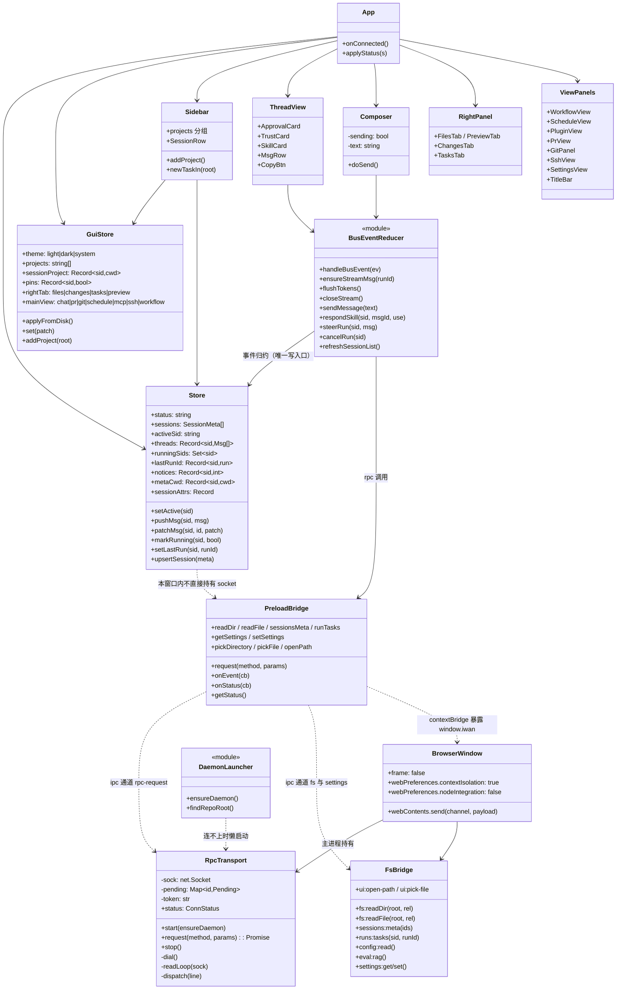
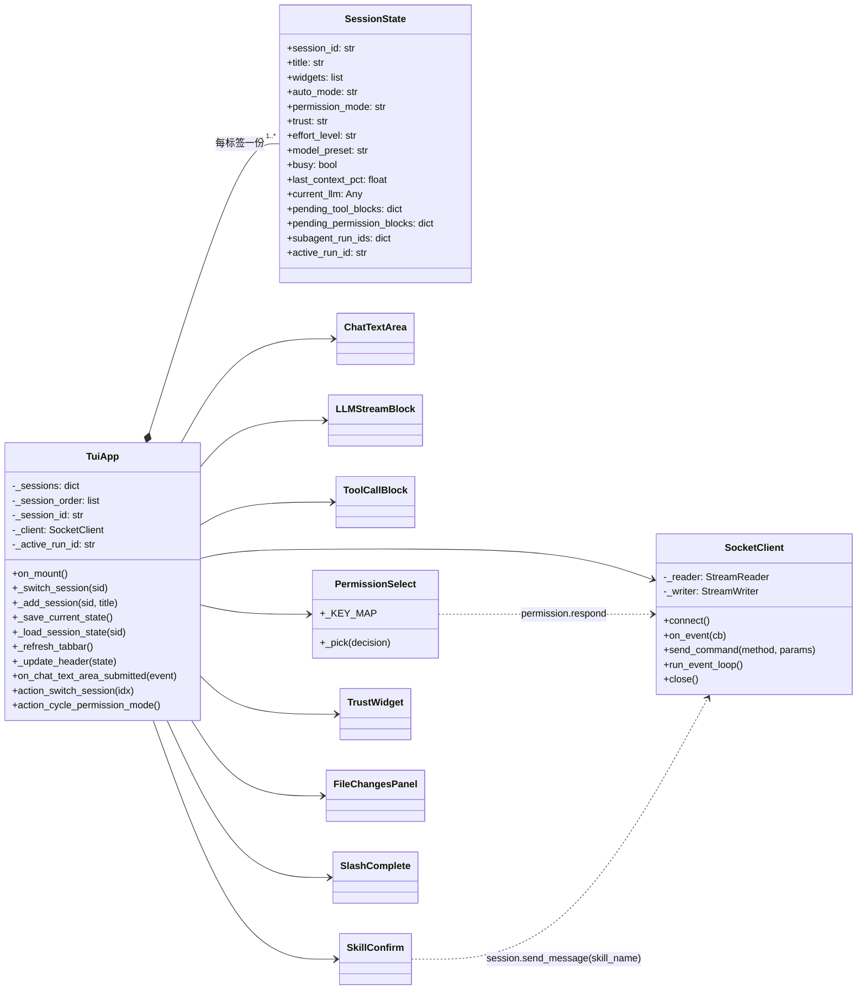

# 05 静态模型 · 类图（客户端：Electron GUI / Textual TUI）

**回答的问题**：两个客户端各自怎么"记住"界面状态、怎么把 daemon 事件翻译成视图。

## 图 A：Electron GUI 的三层与状态归属

## 图 B：Textual TUI 的单 App 多会话

## 读图要点（客户端设计的三个共性决策）

1. **daemon 是唯一事实源，客户端只做归约**：`Store` 的每个字段几乎都能对应到一条事件（`runningSids` ← `run.started/finished`，`metaCwd` ← 磁盘 meta + `session.created`，`contextPct` ← `llm.usage`）。GUI 里唯一的"本地真相"是 `useGui`（主题/项目表/置顶），它落 `~/.iwan/gui.json`，daemon 完全不知道——这是 VS Code 的 "settings vs runtime" 双轨。
2. **事件 → 视图要走"归属表"**：`runOwner: Map<run_id, sid>` 把只有 `run_id` 的事件（`llm.token`/`step.*`/`tool.*`）路由到正确会话的线程；`run.started` 现在自带 `session_id`，所以归属不再靠 `goal === 用户原话` 猜（`store.ts:509-531`）。
3. **TUI 的状态是"每标签一份"**：`_SessionState` 把 widgets/busy/pending 审批/子 Agent 计时全挂在会话上（`tui/models/session_state.py`），切标签 = 换一组 widget 指针，不动后台 run——这是它能"后台会话继续跑"的原因。

## 客户端级并发的历史坑（已修，详见 17 号评估）

- 修复前：`Composer.sending` 是**窗口级**布尔（组件只有一份实例），而 `session.send_message` 的响应要等整个 run 结束才返回（daemon 侧 `manager.py:489` `await run_task`），于是**一条 run 未结束前，同一窗口发不出第二条任务**。
- 修复后：`sendingSids: Set<string>` 按会话记账，`sendMessage` 进入置位、整轮结束清零；`Composer` 只读当前会话那一位，A 在跑不影响 B。
- 修复前：流式合并用单一 `activeStream` 槽位 + 无参 `closeStream()`，并发两条 run 时 A 的尾段会被 B 的 `run.finished` 连坐丢掉。
- 修复后：`streams: Map<runId, …>`，`flushTokens` 遍历所有活跃流、同帧一次 `setState`；`closeStream(runId)` 只关自己；断线时 `resetStreams()` 清光标。

## 代码锚点

- GUI 主进程：`gui/src/main/{index.ts,rpc-transport.ts,fs-bridge.ts,daemon.ts}`
- GUI 桥：`gui/src/preload/index.ts`
- GUI 状态与归约：`gui/src/renderer/src/{store.ts,gui.ts,guiHelpers.ts}`
- TUI：`src/iwan_claude/tui/app.py`、`tui/models/session_state.py`、`tui/widgets/*`
