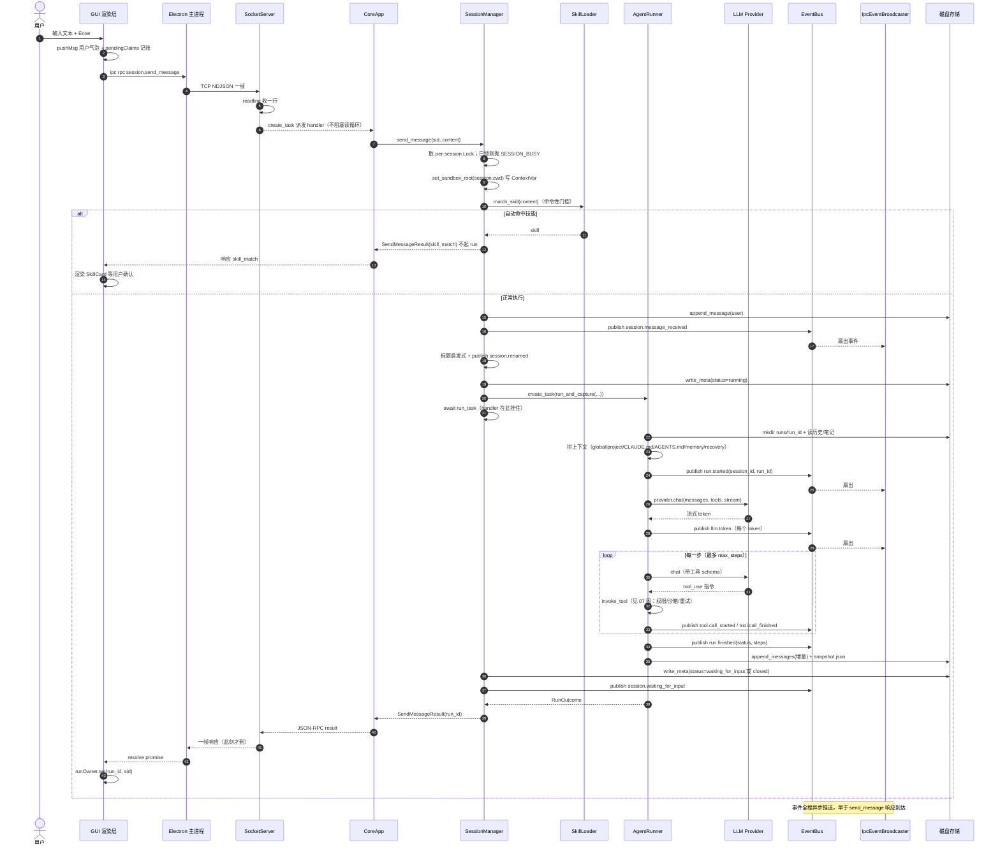

# 06 动态模型 · 时序图：一次对话任务的完整旅程

**回答的问题**：用户按下回车后，一条消息经过哪些对象、在哪个时刻产生哪个事件、响应何时才回到客户端。

## 图

## 读图要点

1. **`create_task` 是并发的地基**：`_read_loop` 对每行单独起 Task（`socket_server.py:365`），所以 `session.send_message` 挂住整个 run 期间，同一条连接上的 `permission.respond`、`run.cancel`、`event.subscribe` 仍能立即被处理——这是"运行中还能审批/停止"的前提。
2. **响应晚于事件**：daemon 要等 run 结束才回包（`manager.py:489` `await run_task`），所以 GUI 里能看到"回复都流完了，`sendMessage` 的 promise 才 resolve"。GUI 的 `store.ts:813-816` 注释明确记录了这个反直觉顺序，并因此用 `pendingClaims` 做事件认领而不是 `markRunning(true)`。
3. **失败/取消也走同一条出口**：`run.finished` 的 `status` 是 `success|failed`（`context.py:70`），取消会先 `mark_failed("cancelled")` 再重抛 `CancelledError`（`runner.py:1331-1335,1364-1365`），外层 `SessionManager` 再补会话状态——所以不存在"取消了但会话卡在 running"。
4. **技能是"半成品响应"**：命中自动匹配时 daemon **不建 run、不落盘消息**，直接回 `skill_match`（`manager.py:340-347`）。GUI 若没有这个分支，用户气泡会成为黑洞（`store.ts:828-843` 记录了这个真实事故）。

## 时序里的超时与清理

| 环节 | 超时/上限 | 位置 |
|---|---|---|
| 单步循环 | `agent.max_steps`（默认见 `config.py` `AgentConfig`） | `runner.py:1116` |
| 工具执行 | `wait_for(tool.invoke)` 超时后按错误类型退避重试 | `tools/invocation.py:337-403` |
| 审批等待 | `wait_for(future, timeout_s)`，超时视为 `timeout` 决策 | `permissions/manager.py:618` |
| run 取消 | `run.cancel` → `run_registry` 按 run_id 找到 Task 注入 `CancelledError` | `run_registry.py`、`manager.py:486-502` |

## 代码锚点

`session/manager.py:255-565`、`runner.py:997-1372`、`transport/socket_server.py:325-450`、`events/bus.py`、`transport/ipc_broadcaster.py:153-256`
