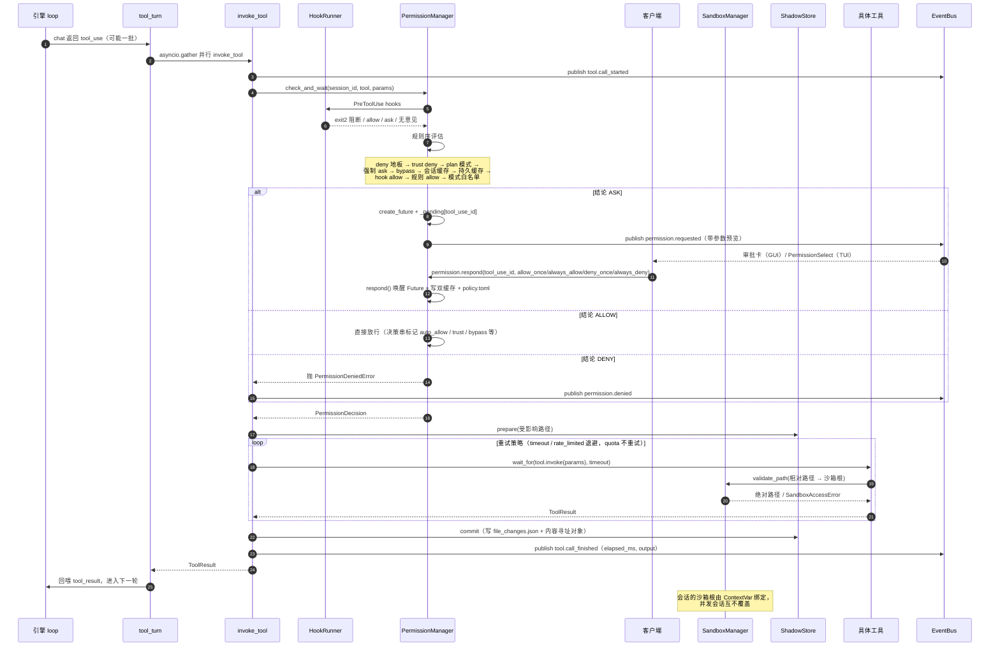

# 07 动态模型 · 时序图：工具调用与权限审批（五层安全闸门）

**回答的问题**：模型说"我要执行 `rm -rf build`"之后，到底被几道门检查过、卡在哪一道、用户点"允许"之后发生了什么。

## 图

## 五层闸门（按 `permissions/manager.py:441-590` 的真实顺序）

| # | 闸门 | 作用 | 代码 |
|---|---|---|---|
| 1 | **Hooks PreToolUse** | 用户自定义脚本，`exit 2` 可强制阻断并回灌 stderr | `core/hooks/`、`manager.py:506` |
| 2 | **deny 地板** | legacy 黑名单 + 规则 `deny`，宽 deny 不可被窄 allow 例外 | `policy.py:545-565` |
| 3 | **TrustStore 目录信任** | 会话 cwd 的 `allow/deny/ask` 档，`deny` 直接拒 | `manager.py:528`、`trust.toml` |
| 4 | **plan / 强制 ask / bypass** | 权限模式的覆盖层：plan 只读、forced ask、bypass 跳规则但 managed deny 仍生效 | `manager.py:534-542` |
| 5 | **规则 allow / 模式白名单** | 规则库匹配成功才免问；否则 default-ask | `manager.py:575-590` |

## 读图要点

1. **"要不要问人"和"能不能动这个文件"是两件事**：`PermissionManager` 只回答前者；后者由每个工具自己 `validate_path`（`read_file.py:118`、`write_file.py:76`），越界抛 `SandboxAccessError`（`PermissionError` 子类）。所以即使 bypass 全放行，路径仍被沙箱卡死。
2. **一批 tool_use 是并行执行的**：`tool_turn.py:127-137` 用 `asyncio.gather` 并发调 `invoke_tool`，但每个 `tool_use_id` 一个独立 Future，审批互不阻塞（`manager.py:594`）。
3. **影子快照让"改错了"可回滚**：`prepare` 在调用前记录受影响路径的原内容，`commit` 在成功后写 `file_changes.json`；失败/取消则不落账。GUI 右栏「变更」页签读的就是它（`files.changes` / `files.restore`）。
4. **`.env` 类的敏感文件有两道独立保护**：规则层 `Read(./.env)` 的 gitignore 语义 + 沙箱层的路径校验——两道都过才读得到。

## 已知边界

- `manager.py` 的注释承认：`rm -rf` 这类破坏性形态**没有硬编码规则**，靠 default-ask + 模型保守性 + hooks——与 Claude Code 官方行为一致，不是遗漏。
- 只有 `write_file` 明确调用了 `check_total_quota`（`write_file.py:277-279`），其余写工具只做单文件大小检查；配额是"软约束"。

## 代码锚点

- 调用链：`core/tool_turn.py:74-139` → `core/tools/invocation.py:168-410`
- 决策链：`core/permissions/manager.py:441-600`、`core/permissions/policy.py`
- 沙箱：`core/sandbox.py:250-360`（validate/配额）
- 影子：`core/shadow/`、`runner.py:1302-1329`（每 run 挂 ContextVar）
