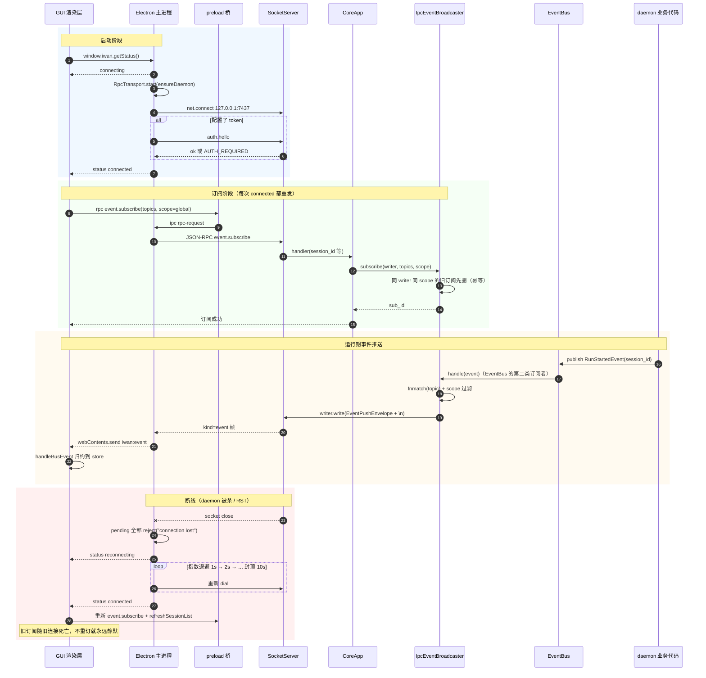

# 08 动态模型 · 时序图：事件订阅、广播与断线重连

**回答的问题**：daemon 里的一条事件怎么走到界面上、为什么"重连后要重新订阅"、以及"同一条事件被刷四遍"这类 bug 的根因。

## 图

## 读图要点

1. **两条订阅链**：`EventBus` 是进程内的（`EventWriter` 落盘、`SnapshotWriter` 存快照、`IpcEventBroadcaster` 推客户端），`IpcEventBroadcaster` 是进程外的（按 `topics` glob + `scope` 过滤）。所有层只 `publish`，不知道谁在听。
2. **重连必须重订阅**：订阅挂在 `(writer, scope)` 上，旧连接死则订阅失效；GUI 在每次 `status === connected` 都发一次 `event.subscribe`（`App.tsx:71-84`），TUI 同源。
3. **幂等收敛是防重复的关键**：早先 `subscribe` 无条件 append，同一 writer 会堆 N 份订阅，`handle()` 就按 N 份重复下发——表现为"审批卡刷四张、消息回很多遍"。修复在 `ipc_broadcaster.py:131-134`：同 writer 同 scope 先撤旧再记新（`global` 与 `run:x` 可并存）。
4. **漏订 topic 是静默故障**：`topics` 是服务端过滤清单，漏订不会报错，只是永远收不到。GUI 一次订齐 `session.* run.* step.* tool.* llm.* permission.* trust.* subagent.* skill.* context.* schedule.* ssh.* workflow.* plugin.*`（`App.tsx:74-78`）；历史事故：漏订 `ssh.*` 导致"终端能开能敲但零输出"。

## 事件分类速查

| 事件族 | 关键字段 | 客户端用途 |
|---|---|---|
| `run.started / run.finished` | `run_id`, `session_id`, `status`, `steps` | 运行灯、完成提示、run 归属表 |
| `llm.token / llm.usage / llm.model_selected` | `run_id`, `token`, `context_pct` | 流式气泡、上下文占用、模型角标 |
| `tool.call_started/finished/failed` | `run_id`, `tool_use_id`, `params/output` | 工具卡片、耗时、失败原因 |
| `permission.requested/granted/denied` | `tool_use_id`, `param_preview` | 审批卡与"已答复"回声 |
| `trust.requested/changed` | `cwd`, `decision`, `persistent` | 目录信任卡 |
| `session.*` | `session_id`, `title`, `status` | 会话列表、标签栏、标题精修 |
| `subagent.* / skill.* / context.*` | `run_id` / `skill_name` / 压缩信息 | 子 Agent 行、技能卡、压缩提示 |
| `workflow.node / workflow.finished` | `workflow_id`, `run_id`, `node`, `status` | 工作流 DAG 上色 |
| `schedule.fired` | `task_id`, `run_id`, `ts` | 定时任务回显 |
| `ssh.output / ssh.closed` | `session_id`, `data_b64` | xterm 写字节流 |
| `hook.evaluated / plugin.changed` | — | 设置页诊断、插件面板刷新 |

## 代码锚点

- 广播器：`core/transport/ipc_broadcaster.py`（`subscribe:100`、`handle:153`、`_matches_topic:209`、`_matches_scope:230`）
- 服务端订阅入口：`core/app.py:_subscribe_handler`、`socket_server.py` 的 `_handle_line`
- GUI 连接状态机：`gui/src/main/rpc-transport.ts:66-167`
- GUI 订阅点：`gui/src/renderer/src/App.tsx:68-97`
