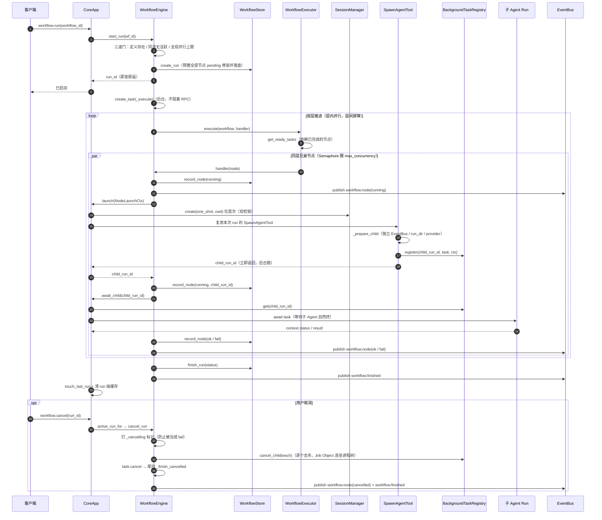

# 09 动态模型 · 时序图：工作流与子 Agent（DAG 并行）

**回答的问题**：`workflow.run` 之后，一个 DAG 节点是怎么变成"一个后台子 Agent 在跑"的，兄弟节点凭什么能并行、取消又怎么传下去。

## 图

## 读图要点

1. **一个节点 = 一个后台子 Agent**，不是"在引擎协程里直接跑"：`_workflow_launch` 调 `SpawnAgentTool.spawn_background`（`app.py:1112-1118`），子 Agent 有自己的 `ExecutionContext`、`EventBus`、run 目录，事件桥接回父 bus（`subagent/tool.py:190-193`）。
2. **双检锁只为防"孤儿会话"**：同层兄弟并发 launch 时，若各自 `create(one_shot)` 会开出两条会话、后者覆盖前者，落在孤儿会话里的审批卡没人能批（节点挂到超时）。所以用一把全局锁 + 二次检查（`app.py:1075-1094`）。
3. **并行度有三层闸**：`max_concurrency`（executor 的 Semaphore）、全局 workflow 并行上限（`start_run` 的门）、子 Agent 批量 `Semaphore`（`tool.py:347-353`）。三层都是"降级为排队"，不是拒绝。
4. **取消要"分得清是谁的 CancelledError"**：子任务被 `registry.cancel` 杀 → 收口成失败结果；引擎协程自己被取消 → 必须原样上抛，否则 `workflow.cancel` 会被吸收成"节点执行失败"而非 `cancelled` 终态（`app.py:1129-1137` 的注释就是这个坑）。
5. **崩溃后的孤儿清算**：daemon 启动时 `mark_orphans_interrupted()`（`app.py:2392`），客户端一连上就看到 `running` 变成 `interrupted`，不会永远转圈。

## 状态取值（画状态图 12 时引用）

- 工作流 run：`running | success | failed | interrupted | cancelled`
- 节点：`pending | running | ok | fail | cancelled`
- 子 Agent ctx：`success | failed | cancelled`；批量行另有 `unknown | running | success | failed | cancelled`

## 代码锚点

- `core/workflow/engine.py:149-330`、`core/workflow/executor.py:85-200`、`core/workflow/graph.py:134-260`、`core/workflow/store.py:271-370`
- 装配与回调：`app.py:1069-1153`、`app.py:2391-2402`
- 子 Agent：`core/subagent/tool.py`（`spawn_background:257`、`_prepare_child:147`、`registry.register:246`）、`core/subagent/registry.py`
