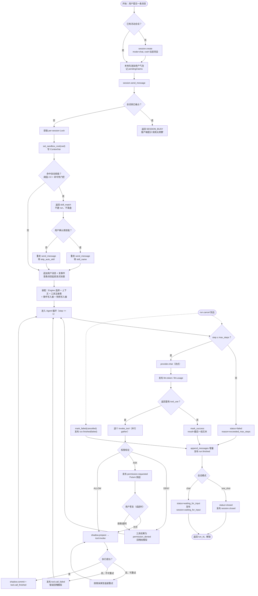

# 10 动态模型 · 活动图：从按下 Enter 到 run 结束

**回答的问题**：控制流上到底有几个判定点、每个判定拒绝时会走到哪个出口（这是"过程视角"的一张图，对应 06 的"对象视角"）。

## 图

## 读图要点

1. **两个"软失败"出口不重试**：`exceeded_max_steps` 与 `cancelled` 都是正常收口——前者防死循环，后者是用户意图；都不会让会话卡在 `running`。
2. **拒绝不是抛错，是"回喂"**：权限被拒后工具结果是 `permission_denied` 文本，模型看到后通常自己换方案（`invocation.py:300-315`）——这是 agent 能"遇到拒绝继续想办法"的原因。
3. **技能的确认是"重发"而非"续跑"**：确认后客户端带 `skill_name` 再发一次，daemon 侧第一次调用根本没落盘消息，所以不会出现两条用户气泡（`store.ts:847-877` 用 `echoSuppress` 吞掉 `session.message_received` 回声）。
4. **锁的位置**：`lock.locked()` 预检查在进入 `async with lock` 之前（`manager.py:314-327`），所以"同一会话连点两次"第二次立刻 `SESSION_BUSY`，而不是排队——这是刻意的（排队会让用户以为没反应）。

## 代码锚点

`session/manager.py:255-565`（主流程）、`tools/invocation.py:168-410`（工具分支）、`runner.py:1155-1365`（循环与收尾）、`context.py:227-249`（状态收口）
