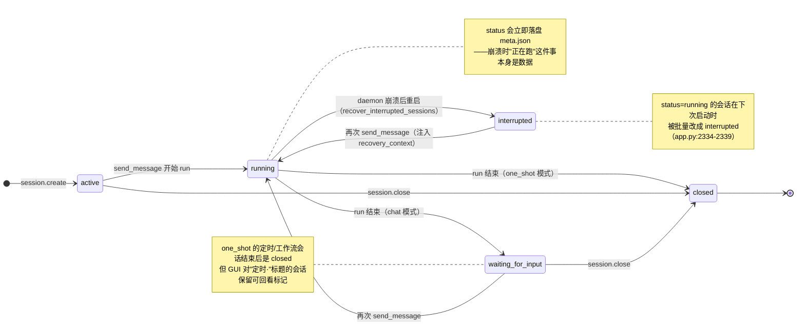

# 11 状态图 · 会话生命周期

**回答的问题**：一个 session 的 `status` 会经历哪些取值、谁触发迁移、崩溃后怎么恢复。

## 图

## 状态取值与语义

| 状态 | 含义 | 谁能进入 | 关键代码 |
|---|---|---|---|
| `active` | 已创建，尚未开始第一次 run | `create()` | `manager.py:197` |
| `running` | 正在执行 run（**会持久化**） | `send_message` | `manager.py:464` |
| `waiting_for_input` | run 正常结束，等下一句 | chat 模式收尾 | `manager.py:552-561` |
| `interrupted` | 上次进程死在 run 中 | 启动时批量改写 | `manager.py:604-638` |
| `closed` | 已关闭，不可再发 | one_shot 收尾 / `close()` | `manager.py:548-551` |

## 与 run 状态的区别（容易混）

- **session.status** 是"这个对话还能不能继续"；**run.status**（`running/success/failed`，`context.py:70`）是"这一轮跑成什么样"。
- 一次会话可以有多轮 run（`run_ids: list`），每轮都有独立 run 目录、事件流、快照；会话状态只反映"当前有没有在跑/能不能再跑"。
- 关闭是**软关闭**：`close()` 只改状态位，历史文件不删（`sessions/<sid>/` 保留 thread.jsonl / notes.md / runs）。

## 崩溃恢复的真实链路

1. `send_message` 先把 `status="running"` 写盘（`manager.py:463-465`）——所以"正在跑"这件事本身是持久化数据。
2. 进程被杀 → 下次 `CoreApp.run()` 调 `recover_interrupted_sessions()`，把 `running` 批量改 `interrupted`（`app.py:2334-2339`）。
3. 用户再次发消息 → `_build_recovery_context(sid)` 找最新 `snapshot.json`，把断点渲染成自然语言注入 system prompt（`manager.py:458-461`、`snapshot.py`）。
4. 于是"从断点继续"不是玄学，而是**读快照 + 重新拼上下文**。

## 代码锚点

`core/session/model.py:39`（状态字面量）、`core/session/manager.py:604-638`、`core/snapshot.py`、`core/app.py:2334-2339`
