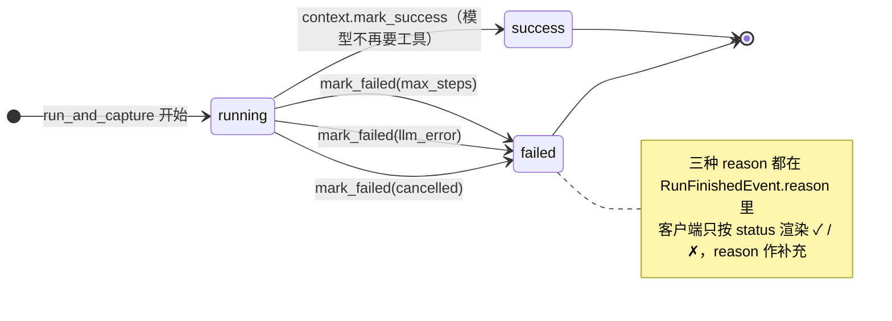
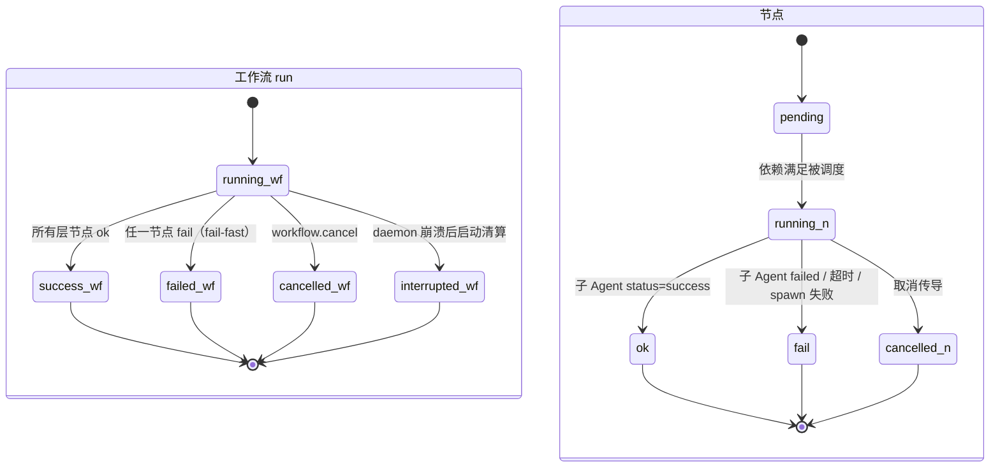
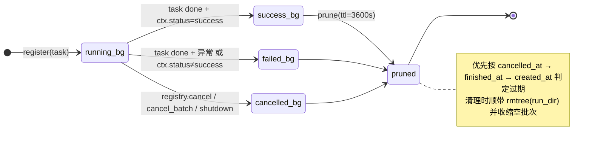

# 12 状态图 · run / 工作流节点 / 后台子任务

**回答的问题**：除"会话"之外，系统里还有三层各自独立的状态机，它们的状态取值从哪来、终态怎么判定。

## 图 A：一次 run（ExecutionContext）

## 图 B：工作流 run 与节点

## 图 C：后台子 Agent（BackgroundTaskRegistry 的推断状态）

## 读图要点

1. **状态来自"谁写"，不是"谁猜"**：run 的终态由 `ExecutionContext.mark_*` 决定；工作流节点终态由 `WorkflowEngine` 在 `await_child` 返回后 `record_node`；子 Agent 状态由注册表**推断**（`task.cancelled() / exception / ctx.status`），不是单独字段维护——少一份真相就少一处不一致。
2. **fail-fast 是刻意的**：`WorkflowExecutor` 单节点异常即 `raise RuntimeError`（`executor.py:157`），同层其它节点会被取消；要"部分成功继续跑"得自己在外层拆工作流。
3. **取消有三种来源但只有一个终态**：用户 `workflow.cancel`、daemon 关停 `shutdown()`、节点超时——最终都落 `cancelled`，区别只在 `reason`。
4. **`interrupted` 是"上一个进程死了"的墓志铭**：`mark_orphans_interrupted()` 在 `server.start()` **之前**执行（`app.py:2389-2392`），保证客户端第一眼看到的不是永远转圈的 `running`。

## 状态取值全集（代码核对）

| 层 | 取值 | 位置 |
|---|---|---|
| run | `running` / `success` / `failed` | `context.py:70` |
| 工作流 run | `running` / `success` / `failed` / `interrupted` / `cancelled` | `workflow/engine.py:222-263`、`store.py:279,367` |
| 工作流节点 | `pending` / `running` / `ok` / `fail` / `cancelled` | `engine.py:304,327,339,272`、`store.py:283-288` |
| 子 Agent ctx | `success` / `failed` / `cancelled` | `subagent/tool.py` |
| 批处理行 | `unknown` / `running` / `success` / `failed` / `cancelled` | `subagent/registry.py:399-425` |

## 代码锚点

`core/context.py`、`core/workflow/{engine,executor,store}.py`、`core/subagent/{registry,tool}.py`
