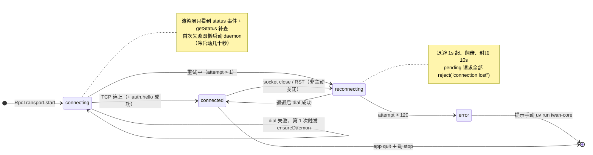
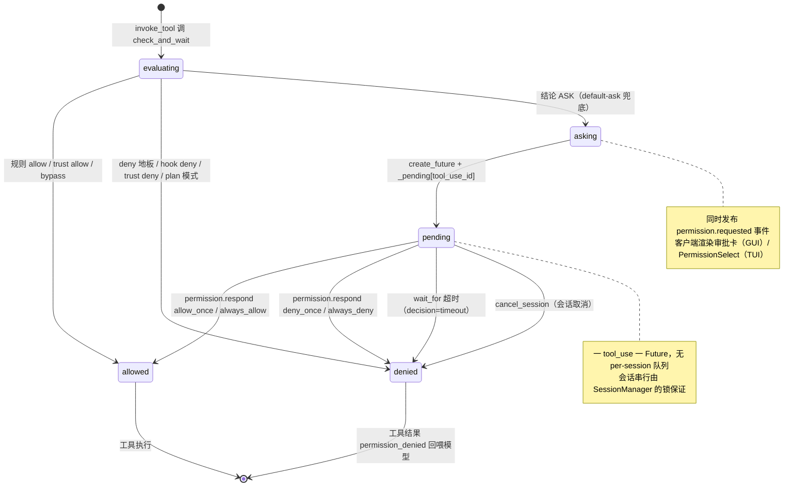

# 13 状态图 · 客户端连接与审批挂起

**回答的问题**：GUI 的连接状态机长什么样、断了之后凭什么能自己接上；以及一次审批从"发起"到"有人答复"的等待链。

## 图 A：Electron 主进程的连接状态机

## 图 B：一次权限请求的挂起-唤醒

## 读图要点

1. **连接状态是"客户端自己的"，不是 daemon 的**：daemon 只知道连接、不知道"重连中"。所以重连后必须重发 `event.subscribe`，否则会处于"连上了但听不见"的假活状态。
2. **`connecting → error` 的阈值是 120 次尝试**（约 2 分钟），配合首次失败即 `ensureDaemon()`——这就是"双击 `iwan work` 什么都不用管"的实现（`daemon.ts` + `rpc-transport.ts:66-90`）。
3. **审批用 Future 而不是轮询**：`check_and_wait` 里 `create_future` 然后 `await wait_for(future, timeout)`；`permission.respond` RPC 只是 `future.set_result(...)`。所以"答复"能在任意一条连接上到达（GUI、TUI 任一客户端都行）。
4. **审批结果会写回策略**：`_apply_response` 不仅唤醒 Future，还把 `always_allow/always_deny` 写进会话缓存 + 持久缓存 + `policy.toml`（`permissions/manager.py:682-760`）——"以后都别问"是落盘的。

## 代码锚点

- 连接：`gui/src/main/rpc-transport.ts:66-223`、`gui/src/main/daemon.ts`
- 审批：`core/permissions/manager.py:441-762`、`core/bus/events.py:550-620`
- 客户端呈现：`gui/src/renderer/src/components/ThreadView.tsx`（ApprovalCard）、`tui/widgets/permission.py`
