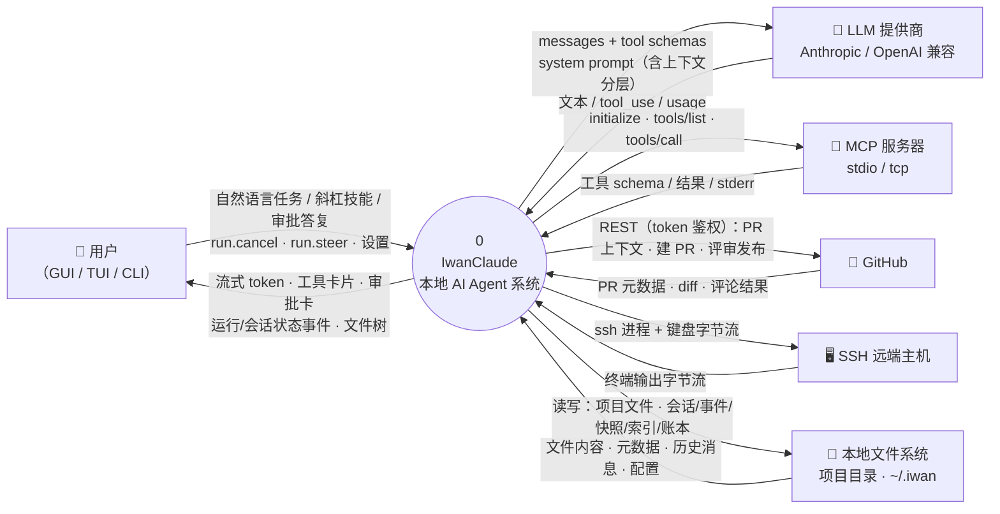

# 14 DFD 0 层 · 上下文图（系统与外部世界的边界）

**回答的问题**：把整个 IwanClaude 当成一个黑盒，它跟哪些外部实体交换什么数据。

## 图

## 外部实体清单与耦合方式

| 外部实体 | 交换什么 | 由谁发起 | 失败时系统行为 |
|---|---|---|---|
| 用户（三个客户端） | 命令 / 事件 | 双向 | 连接状态机退避重连、`error` 态提示手动起 daemon |
| LLM 提供商 | messages ↔ tokens | 每步 chat | 异常 → `mark_failed("llm_error")`，`RunFinishedEvent` 带 reason |
| MCP 服务器 | tools/list · tools/call | 启动时 & 每次调用 | `McpServerUnavailableError` / 熔断 `_offline`，工具名带 `mcp__server__tool` 前缀 |
| GitHub | PR 上下文/创建/评审 | 用户触发或 opt-in 轮询 | 结果以 `pr.reviewed` / 文本错误回给客户端 |
| SSH 主机 | 终端字节流 | 用户开终端 | `ssh.closed` 事件 + Job Object 连坐击杀 |
| 本地文件系统 | 一切持久化 | 双向 | 原子写（tmp + replace）、配额、影子回滚 |

## 读图要点

1. **"本地优先"体现在边界上**：唯一的推理依赖是 LLM API；会话、事件、快照、索引、信任、账本全部落在 `~/.iwan/` 与项目目录，断网仍可看历史、回滚、跑已有知识库检索（除 embedding 需本地模型）。
2. **MCP 是被"拉进来的"外部工具**：daemon 不把 MCP 当服务依赖，而是把它的工具注册进每次 run 的 `ToolRegistry`（前缀 `mcp__`），所以 MCP 挂了只影响那几个工具。
3. **GitHub 与 SSH 都是"进程内代理"**：没有云端中继，全部由本地 daemon 直接发起——`ssh.exe` 的进程树还被 Windows Job Object 兜住，daemon 死则一起死。

## 代码锚点

`core/app.py:2290-2417`（装配出所有对外能力）、`core/llm/*`、`core/mcp/*`、`core/ssh/*`、`core/pr.py`、`core/session/store.py`
