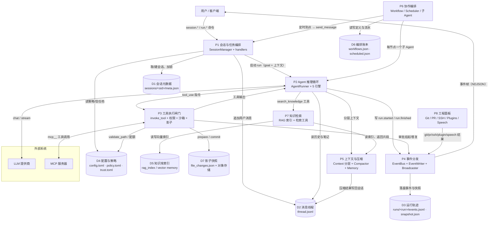

# 15 DFD 1 层 · 进程内分解（8 个加工 + 7 个数据存储）

**回答的问题**：把黑盒打开，daemon 内部有哪些"数据加工"、它们读写哪些持久化存储、数据怎么流动。

## 图

## 加工说明（每个加工 = 一组职责内聚的模块）

| 加工 | 输入 | 输出 | 关键约束 |
|---|---|---|---|
| P1 会话与任务编排 | 命令、cwd、技能名 | run 启动、会话状态 | **per-session 锁**，并发会话互不阻塞，同会话第二次必 SESSION_BUSY |
| P2 Agent 推理循环 | goal + 上下文 + 工具 schema | 文本、tool_use、run 终态 | 最多 `max_steps`；上下文按 6 层拼装（global/project/CLAUDE.md/AGENTS.md/memory/recovery） |
| P3 工具执行闸门 | tool 名 + 参数 | ToolResult / permission_denied | 规则序 deny→ask→allow；每工具自校验沙箱路径；影子快照可回滚 |
| P4 事件分发 | 任意 `bus.publish` | 事件帧 + 落盘 + 快照 | topic glob + scope 过滤；订阅对 (writer, scope) 幂等 |
| P5 上下文与压缩 | 历史、记忆、RAG 片段 | system prompt、压缩摘要 | 超阈值自动压缩；压缩后写回 thread |
| P6 协作编排 | 工作流定义 / 定时规则 | 子 run、会话 | 装配层注入回调，不 import 会话层；取消可传导到注册表 |
| P7 知识检索 | 查询 / 目录 / 文件 | 片段 + 分数 | 混合检索（向量 + 关键词改写）；索引落 D5 |
| P8 工程面板 | Git/PR/SSH/插件请求 | 结构化结果 + 事件 | 全部走本地进程/HTTP，不经云端中继 |

## 数据存储说明

| 存储 | 路径 | 谁写 | 谁读 |
|---|---|---|---|
| D1 会话元数据 | `~/.iwan/sessions/<sid>/meta.json` | P1（状态变化时） | P1、GUI 文件桥（分组用 cwd） |
| D2 消息线程 | `.../<sid>/thread.jsonl` + `notes.md` | P1/P2/P5 | P2（拼上下文）、`session.get_history` |
| D3 运行轨迹 | `.../<sid>/runs/<run_id>/{events.jsonl,snapshot.json,file_changes.json}` | P2/P4 | 崩溃恢复、`session.checkpoint.*` |
| D4 配置与策略 | `~/.iwan/config.toml`、`policy.toml`、`trust.toml` | 用户/P3（always_allow 落盘） | 全系统 |
| D5 知识库 | `.iwan/rag_index`（项目内）/ 向量记忆 | P7 | P7 |
| D6 编排账本 | `~/.iwan/workflows.json`、`workflow_runs.json`、`scheduled.json` | P6 | P6、GUI 面板 |
| D7 影子快照 | 会话级 shadow 对象 + run 级 `file_changes.json` | P3 | `files.changes` / `files.restore` |

## 读图要点

1. **P4 是唯一"什么都不做、只转发"的加工**：它不产生业务数据，只保证"发生过的事"既能落盘（审计/恢复）又能到达所有客户端（UI 一致性）。
2. **P2↔P3 是一个循环**：`tool_use → 执行 → tool_result 回喂` 构成 agent 的心跳；`max_steps` 是这个循环的唯一刹车。
3. **P6 不直接调 P1 的 `send_message` 做工作流**：工作流节点走 `SpawnAgentTool`（P6 → P2 的后台子 run），只有**定时任务**才复用 `P1.send_message`——这条差别决定了"工作流节点不占会话锁、定时任务占"。
4. **D3 是"可恢复性"的全部来源**：事件流 + 快照 + 改动账本，三者合起来支撑崩溃恢复、检查点回滚、文件级撤销。

## 已知不一致（读代码时注意）

- `ScheduleFiredEvent` 的 docstring 写"为本次触发新建的 one_shot 会话"，实现是**每个定时任务一个常驻 chat 会话**并复用（`app.py:1166-1216`）。本图按实现画。
