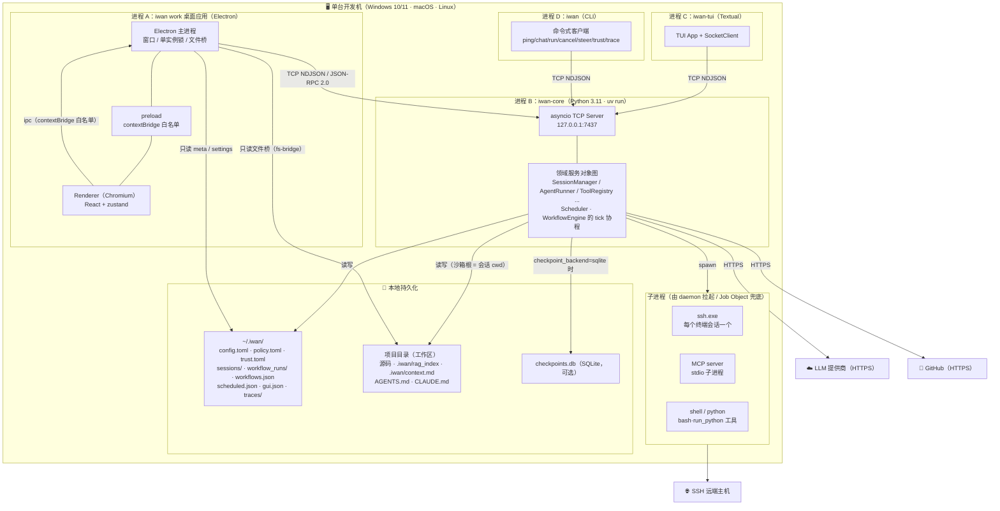

# 16 部署图 · 进程、端口与文件布局

**回答的问题**：这套东西跑起来到底有几个进程、谁连谁、数据落在哪、哪些东西是同一台机器上的。

## 图



## 进程与端口的硬事实

| 项 | 值 | 说明 |
|---|---|---|
| 监听地址 | `127.0.0.1:7437`（`IWAN_HOST` / `IWAN_PORT` 可覆盖） | 只绑回环，不对外网暴露 |
| 分帧 | NDJSON，一行一条 | 单条过大报 `INVALID_REQUEST` |
| 鉴权 | 可选 `auth.hello` + `hmac.compare_digest` | token 空 = 不鉴权（默认本机信任）；来源 `IWAN_TOKEN` 或 `config.toml [core] token` |
| 客户端连接数 | 无限制 | 每个连接独立读循环，`_active_writers` 集合 |
| daemon 生命周期 | GUI 不管它 | GUI 启动时能连上就不管；连不上才 `uv run iwan-core` 懒拉起（`daemon.ts`）；GUI 关闭**不杀** daemon |
| GUI 实例 | 单实例锁 | 第二次启动聚焦已有窗口；daemon 才是允许"多开"的 |
| 子进程兜底 | Windows Job Object | daemon 死 → `ssh.exe`/MCP/shell 进程树连坐击杀 |

## 文件布局（学习时最常翻的三处）

```
~/.iwan/
├── config.toml            # 四层配置的第一层文件（默认 → 此文件 → .env → 环境变量）
├── policy.toml            # 权限规则库（always_allow/deny 落盘处）
├── trust.toml             # 目录信任档（allow/deny/ask，按 cwd）
├── gui.json               # GUI 自身设置（主题/项目表/置顶），daemon 不知道
├── sessions/<sid>/
│   ├── meta.json          # Session 的 to_dict()：id/mode/status/title/run_ids/cwd
│   ├── thread.jsonl       # 完整消息历史（Anthropic 格式 content blocks）
│   ├── notes.md           # 会话笔记（note_save 工具写）
│   └── runs/<run_id>/
│       ├── events.jsonl   # 本次 run 的全部事件（可回放）
│       ├── snapshot.json  # 每步快照（崩溃恢复用）
│       └── file_changes.json
├── workflow_runs/         # 工作流子 Agent 的 run 目录
├── workflows.json         # 工作流定义
├── workflow_runs.json     # 工作流流水（含节点状态）
├── scheduled.json         # 定时任务
└── traces/daemon.jsonl    # trace（layer/kind/run_id/耗时）

<项目目录>/
├── .iwan/rag_index/       # RAG 索引（项目级）
└── .iwan/context.md       # 项目级上下文（注入 system prompt）
```

## 读图要点

1. **两种"本机信任"边界**：客户端↔daemon 走回环 TCP（可选 token）；daemon↔本地文件走沙箱根（会话 cwd）+ 配额。二者都不依赖操作系统账号隔离，**默认假设同机同用户**。
2. **GUI 是"三重进程"**：Electron 主进程（Node）↔ preload（桥）↔ renderer（Chromium）。renderer 摸不到 Node 与 socket——所有能力都必须经 `window.iwan` 白名单。
3. **daemon 的所有并发都在一个事件循环里**：没有线程池跑业务逻辑（只有语音转写/子进程用 `to_thread`/子进程），所以"并发"就是 asyncio 的并发，不是多核并行。
4. **可替换的持久化**：`checkpoint_backend` 支持 `none/memory/sqlite`，SQLite 路径默认锚定在会话根父目录（`resolve_checkpoint_db_path`），避免懒启动 cwd 漂移。

## 代码锚点

`pyproject.toml`（四个入口 `iwan` / `iwan-core` / `iwan-tui` / `iwanclaude`）、`core/config.py`（路径与默认值）、`core/app.py:2411-2417`（server 绑定）、`gui/src/main/daemon.ts`
