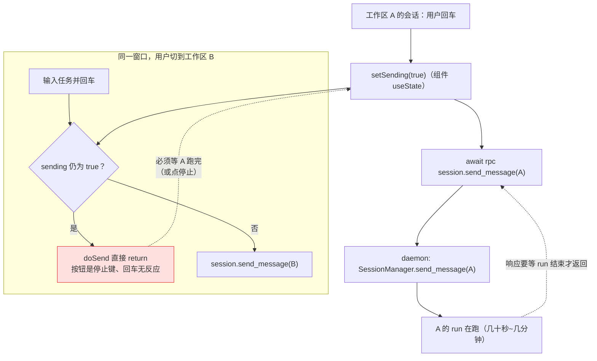
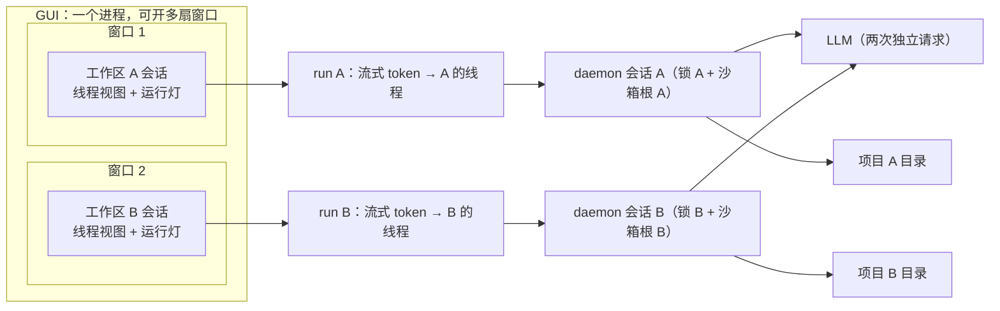

# 17 质量评估 · "两个工作区同时跑多个任务"能不能做到

> 核查时间点：`main@a0e6854`；**修复已落地**（见 §零）。结论分两层：daemon 侧一直真并行，卡点全在 GUI 客户端。

## 零、修复记录（已提交）

三处客户端改动，不动协议、不影响 TUI：

| 改动 | 文件 | 做法 |
|---|---|---|
| 发送在途标志从**窗口级**改为**按会话** | `store.ts`（`sendingSids: Set<string>`、`markSending`）+ `Composer.tsx` | Composer 不再用 `useState`，改读 `sendingSids.has(activeSid)`；`sendMessage` 进入时 `markSending(sid,true)`、整轮 run 结束才清 |
| 回车语义先判"运行中→转向"，再判"同会话在途→忽略" | `Composer.tsx:doSend` | 旧顺序下 `sending` 恰好是本轮在跑的证据，转向被它一起挡掉；新顺序让"随时输入即转向"真的成立 |
| 流式槽位从**单槽**改为**按 run 的 Map** | `store.ts`（`streams: Map<runId,…>`、`closeStream(runId)`） | `flushTokens` 遍历所有活跃流、同帧一次 `setState`；`run.finished` 只关自己那条；新增 `resetStreams()` 在断线时清光标 |
| **多窗口**：一进程多窗、共用一条 daemon 连接 | `main/index.ts`（`bootstrap` + `broadcast` + `senderWindow`）、`preload`、`TitleBar` | ipc 只注册一次；事件向所有窗口广播；窗口控制按 `sender` 定位；顶栏加"新窗口"按钮，`second-instance` 也开新窗而非聚焦旧窗 |
| **迟到窗口自愈**：中途打开/切换的窗口把尾巴补齐 | `store.ts`（`session.waiting_for_input` → `reloadThread`） | 本窗口没见过的 `last_run_id` 且线程已显示时，重拉一次历史；见过的 run 不白拉 |
| 顺带 | `store.ts` + `App.tsx` | `llm.token` 缓冲键从 sid 改成 runId；连接断开（非 connected）时清流式槽位，避免重连后永挂 `▍` |

验证分三层，**端到端那层已经入库可复跑**：

| 层 | 做法 | 结果 |
|---|---|---|
| 端到端（已入库） | `cd gui && npm run test:e2e`：真 Electron 起窗口 + 假 daemon 供协议 + CDP 真按回车真读 DOM | **23 项断言全过**（两窗各收自己回复/互不串台/同窗 A 跑着时发 B/侧栏两个运行点/A 尾段 20/20 完整/迟到窗口补尾 20/20） |
| 主进程接线（一次性桩测） | 把 `main/index.ts` 原样编译，只把 `electron` 换成桩：多窗口创建、事件广播、按 sender 定位、关窗回落 | 15 项全过 |
| 渲染层状态机（一次性） | esbuild 把真实 `store.ts` 打进 Node，喂事件序列 | 17 项全过（并发流各自落位/尾段不丢/工具调用只切本段/两会话同时在途/迟到重拉/不重复重拉） |

> 为什么端到端必须存在：这些性质（两条 run 同时跑、回复只落自己线程）全是渲染层状态机的行为，`tsc` 和单测都证明不了；而 Electron 的启动在本机还踩到两个坑——`ELECTRON_RUN_AS_NODE` 会让它退化成 Node（`require('electron')` 直接失败），默认 `AppData` 不可写时 `process_singleton` 建锁失败会让 app **静默退出**。脚本里分别用 `delete env.ELECTRON_RUN_AS_NODE` 与 `--user-data-dir` 绕开，并在注释里写清了原因。


## 一、结论速览

| 层次 | 两个任务能否同时在跑 | 证据 |
|---|---|---|
| **daemon 内核** | ✅ 能。两个会话（不同 cwd）各 0.6s 的任务总耗时 0.62s | 本次实测脚本（见 §二）+ `socket_server.py:365` 每行 `create_task` |
| **会话级隔离** | ✅ 能。同一会话并发第二次被 `SESSION_BUSY` 拦（不是排队） | 实测 + `session/manager.py:314-317` |
| **沙箱根隔离** | ✅ 能。两个会话各自解析到自己的项目目录，全局默认根不被覆写 | 单测 `tests/unit/test_sandbox.py:888` + `sandbox.py:495-528` |
| **事件归属** | ✅ 基本能。`run.started` 带 `session_id`，客户端按权威锚点建 `runOwner` 表 | `events.py:55-72`、`store.ts:509-531` |
| **GUI 同一窗口再发一条** | ✅ 已修复。发送锁按会话，A 在跑时 B 照常发 | `store.ts` `sendingSids` + `Composer.tsx:doSend` |
| **GUI 第二个窗口** | ✅ 已修复。顶栏「新窗口」/ 再启动一次 = 再开一扇，共用一条 daemon 连接 | `main/index.ts` `broadcast`/`senderWindow`、`preload` `newWindow` |
| **GUI 并发流式渲染** | ✅ 已修复。每 run 一个槽位，互不吞字 | `store.ts` `streams` + `closeStream(runId)` |
| **迟到窗口（中途打开/切换）** | ✅ 已修复。run 结束时按 `last_run_id` 判定"这个 run 我见过没有"，没见过就重拉历史补尾 | `store.ts` `session.waiting_for_input` → `reloadThread` |
| **定时任务 / 工作流 / 另一客户端并发** | ✅ 真实会发生（且已经会发生） | `app.py:1166-1216`、`app.py:1069-1118` |

**一句话**：后端早就为并行设计好了（每会话锁 + ContextVar 沙箱根 + 每行一个 Task）；原先 GUI 把"发送"绑在了整个 run 的响应上，现已改为按会话记账，**同一窗口里 A、B 两个工作区可以同时各跑一条任务，各自流各自的字**。


## 二、实测证据（daemon 侧）

用 `SlowRunner`（每次 run `sleep(0.6)`）替代真 LLM，直接驱动 `SessionManager`，排除网络与模型波动：

```
[跨会话并行] 两个会话各 0.6s，总耗时 0.62s → 并行
[各自 cwd]   A=...\proj-a  B=...\proj-b
[第二轮]     0.61s results=[SendMessageResult, SendMessageResult]
[同会话并发] 被 SESSION_BUSY 拦截 = True
```

- 并行：`asyncio.gather(mgr.send_message(a), mgr.send_message(b))` 总耗时 ≈ 单个任务，说明**两个会话的 run 是重叠执行的**（串行应为 ≥1.2s）。
- 互斥：同一会话第二次调用立刻 `SESSION_BUSY`，说明"每会话串行"的保护仍在。
- cwd：两个会话各自携带自己的项目目录，`send_message` 里 `set_sandbox_root(session.cwd)` 写的是**当前 Task 的 ContextVar**，互不覆写。

> 复核方式：`uv run python runs/_verify_parallel.py`（临时脚本，`runs/` 已在 `.gitignore` 内）。

## 三、修复前的数据流（历史诊断，保留作教学）



**根因链条**（三个文件）

1. daemon 的 `session.send_message` 是**同步式响应**：整个 run 跑完才回包（`manager.py:489` `await run_task`；`app.py:1325` `await self._sessions.send_message(...)`）。
2. 客户端把它当成"一次点击"，用**组件内** `sending` 布尔锁住输入框直到 promise resolve——Composer 全窗口只有一份实例，所以这把锁实际是窗口级的。
3. 于是"每条前端发送"与"每个后端 run"被强行绑成 1:1 串行；而 GUI 的设计又是**单窗口、多会话**——两者叠加就出现"A 在跑，B 不能发"。

## 四、三处客户端缺陷与处置

### 缺陷 1（阻断级，✅ 已修）：窗口级 `sending` 挡住第二个任务

- 原位置：`Composer.tsx` 的 `useState(false)` + `doSend` 的 `if (… || sending || …)`。
- 修法（落地版本）：标志搬进 store 并按会话记 —— `sendingSids: Set<string>` + `markSending(sid, v)`；`Composer` 改读 `sendingSids.has(activeSid)`，`sendMessage` 进入置位、整轮 run 结束（`finally`）清零；`session.create` 在途的那一小段另用 `creatingSession` 防重入。
- 同时修掉一个连带 bug：**转向被自己的发送锁挡住**。旧 `doSend` 先判 `sending` 再判 `running`，而 `sending` 恰恰等于"本轮在跑"，导致"运行中随时输入即转向"是句假话。新顺序：先 `running → steerRun`，再 `sending → 忽略重复回车`。

```ts
// 落地后的关键三行（Composer.tsx）
const sending = useStore((s) => (s.activeSid ? s.sendingSids.has(s.activeSid) : s.creatingSession))
if (running && activeSid) { /* 转向，不受 sending 拦截 */ return }
if (sending) return // 只有"同一会话有在途发送"时才忽略
```

> 更彻底的做法仍是**把 `session.send_message` 改成"立即返回 run_id、结果靠事件"**（协议级改动，TUI 与测试都要跟着改）；本轮没动协议，风险最小。

### 缺陷 2（显示级，✅ 已修）：单流式槽位 + 无参 `closeStream()`

- 原位置：`activeStream` 单槽、`closeStream()` 无参、任何 `run.finished` 都调它。
- 机制（修复前的精确路径）：`tokenBuf` 按 `sid` 攒，但 `flushTokens()` **只把 `activeStream` 那一条**写回气泡；A、B 交替吐 token 时 A 的字滞留在缓冲里，直到 A 再次成为 `activeStream`。
- 后果：若 A 的**尾段** token 恰在 B 持有槽位时到达、之后 A 不再吐字，这段字**永不 flush**；紧接着 A 的 `run.finished` 走到无参 `closeStream()`（flush 的仍是 B），于是 A 的气泡停在半句，界面再补一条裸的"✓ 完成"。
- 落地修法：`streams: Map<runId, {sid, msgId}>`；`flushTokens()` 遍历**所有**活跃流、同帧一次 `setState`（渲染次数不随 run 数增长）；`closeStream(runId)` 只关自己那条；`llm.token` 的缓冲键从 sid 改成 runId；新增 `resetStreams()` 在连接断开时清槽位与残留光标。

### 缺陷 3（体验级，✅ 已修）：只能一扇窗，没法并排看两个工作区

- 原位置：`gui/src/main/index.ts`（`requestSingleInstanceLock` + `win` 单例 + `ipcMain` 在 `createWindow` 里注册）。
- 原状：第二个实例直接 `quit()` 并聚焦已有窗口；窗口控制/目录对话框都用模块级 `win`，即"最后建的那扇"。
- 落地修法：
  - `bootstrap()` 一次性装配 daemon 连接、文件桥与全部 `ipcMain` 通道（多窗口下重复注册会抛错，重连环也只该有一个）；
  - 事件与连接状态用 `broadcast()` 发给**所有**存活窗口；窗口控制/`ui:pick-directory` 一律 `BrowserWindow.fromWebContents(e.sender)` 按发起者定位；
  - 顶栏加"新窗口"按钮（`win:new`），`second-instance` 从"聚焦旧窗"改成"再开一扇"；
  - 每扇窗有独立 renderer 状态（独立 zustand store、独立 `activeSid`），共享主进程那一条 TCP 连接。
- 为什么共用一条连接没问题：daemon 的 `event.subscribe` 幂等键是 `(writer, scope)`，两扇窗发的是**同一份** topics，服务端只保留一条订阅；事件推给这条连接后由主进程广播，各窗口再按 `run.started.session_id → runOwner` 把 token 落进自己那个会话的线程。
- 配套补丁（迟到窗口）：新窗口/新切换的窗口可能错过 `run.started`，此时 `run.finished` 只带 `run_id`、无法定位会话；改为在 `session.waiting_for_input`（带 `session_id` + `last_run_id`）里判断"这个 run 我见过没有"，没见过且线程已显示就重拉一次历史补尾。

## 五、目标态（现已成立）



后端本就支持这张图（实测 + 单测），客户端现已把"发送"从"等待整轮"里解耦、并支持一进程多窗——**A、B 两条 run 各自流式、各自落各自会话的线程**。

## 六、手工验收步骤（修复后应看到什么）

1. `uv run iwan-core` 起 daemon，`npm run dev`（在 `gui/` 下）开 GUI——本仓库没有打包配置，GUI 是开发态运行。
2. 侧栏「添加项目」加两个目录（`项目A`、`项目B`）。
3. 在项目 A 里发一条会跑较久的任务（例如"把这个目录的 Python 文件都加上模块头部注释，逐个确认"）。
4. 运行灯亮起后，切到项目 B 的新任务 → 输入"列一下当前目录结构" → 回车。
5. **预期**：B 立刻发出（用户气泡 + B 的运行灯），两条 run 同时在跑；侧栏两个会话行都显示运行点；A 的流式文字继续出现在 A 的线程里，B 的文字出现在 B 的线程里，互不截断。
6. 在 A 运行时往输入框里打字回车：应作为**转向**（`⚡ 已转向` 提示），而不是新任务。
7. 同一会话在途时连按两次回车：只发一条（第二次被忽略，不再出现"静默黑洞"）。
8. 点顶栏「新窗口」（或再启动一次应用）：开出第二扇窗；窗口 1 停在 A、窗口 2 切到 B 并发任务 → 两扇窗各自实时滚动各自的回复；关掉其中一扇，另一扇的 run 不受影响（run 在 daemon 里，窗口只是观察者）。

## 七、建议补的自动化验收

| 测试 | 断言 | 现状 |
|---|---|---|
| `test_two_sessions_run_concurrently` | 两个会话各 `sleep(0.6)`，`gather` 总耗时 < 1.0s | 已用临时脚本验证，建议入库 |
| `test_same_session_second_send_busy` | 第二次 `send_message` 抛 `SESSION_BUSY` | 已有类似覆盖 |
| `test_concurrent_token_streams_do_not_cross` | 两条 run 交替 token，断言各自气泡内容完整、无互相截断 | **已入库**：`npm run test:e2e` 直接覆盖 |
| `test_gui_composer_not_blocked_by_other_session` | A 在途时 B 的 `doSend` 仍调用 RPC | **已由 e2e 覆盖**（同一窗口 A 运行中发 B，侧栏出现两个运行点） |
| `test_late_window_backfills_tail` | 未见过的 `last_run_id` 的 `waiting_for_input` 触发一次 `session.get_history`，已知的不触发 | **已入库**：e2e 阶段 3 用真窗口验证 |

## 八、代码锚点汇总

- 并发地基：`core/transport/socket_server.py:346-365`、`core/session/manager.py:314-327`、`core/sandbox.py:384-528`
- 发送锁与状态：`gui/src/renderer/src/store.ts`（`sendingSids` / `markSending` / `sendMessage`）、`gui/src/renderer/src/components/Composer.tsx`（`sending` 选择器、`doSend`）
- 流式槽位：`gui/src/renderer/src/store.ts`（`streams` / `flushTokens` / `closeStream(runId)` / `resetStreams` / `reloadThread`）
- 多窗口：`gui/src/main/index.ts`（`bootstrap` / `broadcast` / `senderWindow` / `win:new` / `second-instance`）、`gui/src/preload/index.ts`（`newWindow`）、`gui/src/renderer/src/components/TitleBar.tsx`
- 端到端测试：`gui/scripts/e2e-parallel.mjs`（`cd gui && npm run test:e2e`）
- 已能并行的旁路：定时任务 `app.py:1166-1216`、工作流 `app.py:1069-1118`、多客户端（同一 daemon 多连接）

