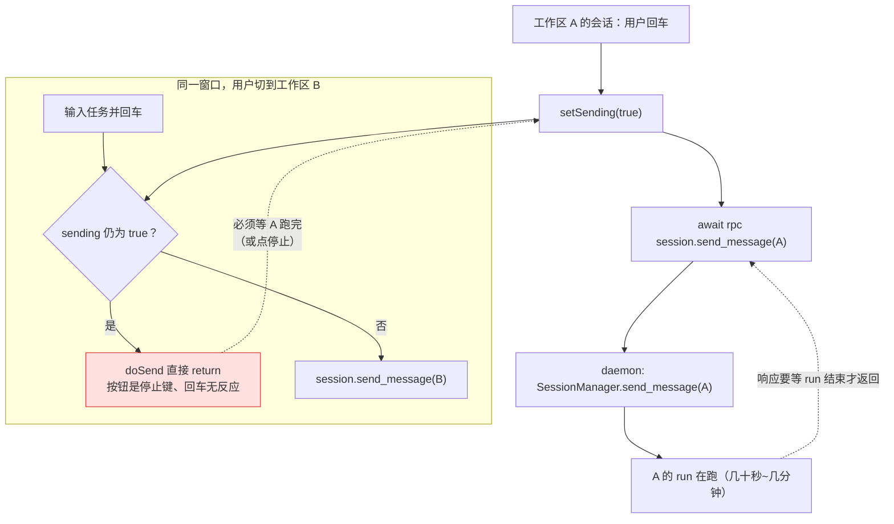
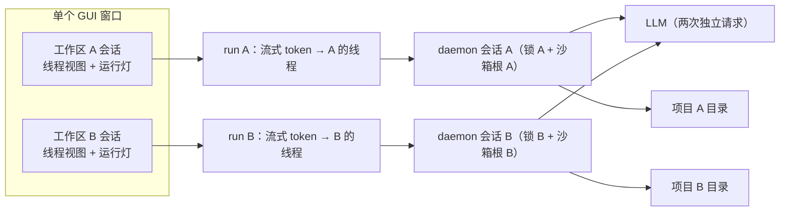

# 17 质量评估 · "两个工作区同时跑多个任务"能不能做到

> 核查时间点：当前 `main` 分支（`d1d03b5`）。结论分两层：**daemon 侧 ✅ 真并行**，**GUI 单窗口 ❌ 发不出第二条**，中间还差 3 处客户端改动。

## 一、结论速览

| 层次 | 能否并行的两个任务同时在跑 | 证据 |
|---|---|---|
| **daemon 内核** | ✅ 能。两个会话（不同 cwd）各 0.6s 的任务总耗时 0.62s | 本次实测脚本（见 §二）+ `socket_server.py:365` 每行 `create_task` |
| **会话级隔离** | ✅ 能。同一会话并发第二次被 `SESSION_BUSY` 拦（不是排队） | 实测 + `session/manager.py:314-317` |
| **沙箱根隔离** | ✅ 能。两个会话各自解析到自己的项目目录，全局默认根不被覆写 | 单测 `tests/unit/test_sandbox.py:888` + `sandbox.py:495-528` |
| **事件归属** | ✅ 基本能。`run.started` 带 `session_id`，客户端按权威锚点建 `runOwner` 表 | `events.py:55-72`、`store.ts:509-531` |
| **GUI 同一窗口再发一条** | ❌ 不能。`Composer.sending` 是窗口级布尔，`doSend` 静默 return | `Composer.tsx:136,280-291` |
| **GUI 第二个窗口** | ❌ 不能。单实例锁聚焦已有窗口 | `gui/src/main/index.ts:1267-1275` |
| **GUI 并发流式渲染** | ⚠️ 会串台。`activeStream` 是单槽、`closeStream()` 全局生效，任一条 `run.finished` 会关掉另一条的流式气泡 | `store.ts:419-470,533-545` |
| **定时任务 / 工作流 / 另一客户端并发** | ✅ 真实会发生（且已经会发生）——这时上面那条 ⚠️ 就会显形 | `app.py:1166-1216`、`app.py:1069-1118` |

**一句话**：后端早就为并行设计好了（每会话锁 + ContextVar 沙箱根 + 每行一个 Task），但 GUI 把"发送"这个动作绑在了整个 run 的响应上，**同一窗口里 A 工作区跑着时，B 工作区按回车是静默失败**。

## 二、实测证据（daemon 侧）

用 `SlowRunner`（每次 run `sleep(0.6)`）替代真 LLM，直接驱动 `SessionManager`，排除网络与模型波动：

```
[跨会话并行] 两个会话各 0.6s，总耗时 0.62s → 并行
[各自 cwd]   A=...\proj-a  B=...\proj-b
[第二轮]     0.61s results=[SendMessageResult, SendMessageResult]
[同会话并发] 被 SESSION_BUSY 拦截 = True
```

- 并行：`asyncio.gather(mgr.send_message(a), mgr.send_message(b))` 总耗时 ≈ 单个任务，说明**两个会话的 run 是重叠执行的**（串行应为 ≥1.2s）。
- 互斥：同一会话第二次调用立刻 `SESSION_BUSY`，说明"每会话串行"的保护仍在。
- cwd：两个会话各自携带自己的项目目录，`send_message` 里 `set_sandbox_root(session.cwd)` 写的是**当前 Task 的 ContextVar**，互不覆写。

> 复核方式：`uv run python runs/_verify_parallel.py`（临时脚本，`runs/` 已在 `.gitignore` 内）。

## 三、当前 GUI 的实际数据流（为什么会卡住）



**根因链条**（三个文件）

1. daemon 的 `session.send_message` 是**同步式响应**：整个 run 跑完才回包（`manager.py:489` `await run_task`；`app.py:1325` `await self._sessions.send_message(...)`）。
2. 客户端把它当成"一次点击"，用 `sending` 布尔锁住输入框直到 promise resolve（`Composer.tsx:281-289`、`store.ts:821`）。
3. 于是"每条前端发送"与"每个后端 run"被强行绑成 1:1 串行；而 GUI 的设计又是**单窗口、多会话**——两者叠加就出现"A 在跑，B 不能发"。

## 四、三处客户端缺陷与最小修复

### 缺陷 1（阻断级）：`sending` 窗口级布尔挡住第二个任务

- 位置：`gui/src/renderer/src/components/Composer.tsx:136, 278-292`
- 现象：A 跑着时在 B 里按回车，无任何反馈（既不发、也不提示）。
- 最小修复（任选）：

```ts
// 方案 A：把 sending 改成 per-session（推荐，语义最正）
const sending = useStore((s) => (activeSid ? s.sendingSids.has(activeSid) : false))
// 发送时只标记"当前会话在途"，不再阻塞其它会话
useStore.getState().markSending(sid, true)
void sendMessage(value).finally(() => useStore.getState().markSending(sid, false))
```

```ts
// 方案 B：fire-and-forget + 事件驱动（更贴近 TUI 的既有做法）
void rpc('session.send_message', { session_id: sid, content: value })
  .catch(...)                     // 不 await 整轮，run_id 由 run.started 事件归属
```

> 更彻底的做法是**把 `session.send_message` 改成"立即返回 run_id、结果靠事件"**（协议级改动，TUI 与测试都要跟着改，收益是彻底消除"1 条 RPC = 1 个 run 时长"的耦合）。

### 缺陷 2（显示级）：单 `activeStream` 槽位 + 全局 `closeStream()`

- 位置：`store.ts:419-423`（`activeStream` 单槽）、`462-470`（`closeStream` 无参）、`533-536`（任何 `run.finished` 都 `closeStream()`）
- 现象（**今天就可能发生**：定时任务在你聊天时触发）：两条 run 交替吐 token 时，`tokenBuf` 按 `sid` 分开但 flush 只写 `activeStream` 那一条；A 的尾段 token 在 B 的 `run.finished` 里被 `closeStream()` 一次性关掉 → **A 的回复缺尾巴 + 出现裸的"✓ 完成"**。
- 修复：把槽位改成 `Map<runId, {sid, msgId}>`，`closeStream(runId)` 按 run 关；`flushTokens` 遍历所有活跃流（`requestAnimationFrame` 里一次 `setState` 批量合并，仍是每帧一次）。

### 缺陷 3（体验级）：无法开第二个窗口做并排观察

- 位置：`gui/src/main/index.ts:1267-1275`（`requestSingleInstanceLock`）
- 现状：第二个实例直接 `quit()` 并聚焦已有窗口。
- 若产品目标是"两个工作区并排看着同时跑"，需要放开多窗口：`createWindow()` 复用同一 `RpcTransport`，每个窗口独立 renderer 状态（`runOwner`/`threads` 目前是模块级，需要按窗口实例化或允许跨窗口重复归约——注意 `event.subscribe` 的幂等键是 `(writer, scope)`，多窗口共用一个连接时会互相覆盖订阅，需要改成订阅表合并）。

## 五、修复后应成立的目标态



后端已经支持这张图（本次实测 + 单测），**只差客户端把"发送"从"等待整轮"里解耦**。

## 六、手工复现步骤（不改代码即可验证现状）

1. `uv run iwan-core` 起 daemon，`npm run dev`（在 `gui/` 下）开 GUI——本仓库没有打包配置，GUI 是开发态运行。
2. 侧栏「添加项目」加两个目录（`项目A`、`项目B`）。
3. 在项目 A 里发一条会跑较久的任务（例如"把这个目录的 Python 文件都加上模块头部注释，逐个确认"）。
4. 运行灯亮起后，点项目 B 的新任务 → 输入"列一下当前目录结构" → 回车。
5. 观察：**没有任何反应**（既无"会话忙"提示，也没有新 run）；点停止键中断 A 后再回车，B 才发得出去。
6. 反向验证后端没问题：另开一个终端跑 `uv run iwan-tui`（或再开一个客户端），在 B 目录发任务——GUI 与 TUI 两条 run 会真正并行（此时可观察上面"缺陷 2"的串台现象）。

## 七、建议补的验收测试

| 测试 | 断言 |
|---|---|
| `test_two_sessions_run_concurrently` | 两个会话各 `sleep(0.6)`，`gather` 总耗时 < 1.0s（本次已手工验证，建议入库） |
| `test_same_session_second_send_busy` | 第二次 `send_message` 抛 `SESSION_BUSY`（已有类似覆盖） |
| `test_gui_composer_not_blocked_by_other_session` | 组件级：A 在途时 B 的 `doSend` 仍调用 RPC（需引入 vitest/jsdom） |
| `test_concurrent_token_streams_do_not_cross` | 两条 run 交替 token，断言各自气泡内容完整、无互相截断 |

## 八、代码锚点汇总

- 并发地基：`core/transport/socket_server.py:346-365`、`core/session/manager.py:314-327`、`core/sandbox.py:384-528`
- GUI 阻断：`gui/src/renderer/src/components/Composer.tsx:136,278-292`、`gui/src/renderer/src/store.ts:788-845`
- 流式串台：`gui/src/renderer/src/store.ts:416-470,533-545`
- 单实例：`gui/src/main/index.ts:1266-1281`
- 已能并行的旁路：定时任务 `app.py:1166-1216`、工作流 `app.py:1069-1118`、多客户端（同一 daemon 多连接）
