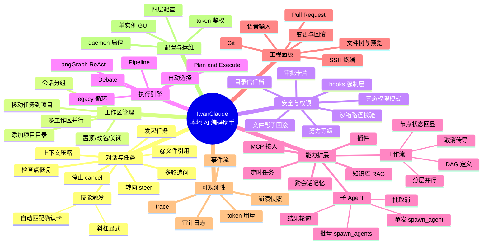

# 18 需求规格 · 功能结构图（功能分解）

**回答的问题**：把所有需求按"产品视角"拆成一棵功能树——这是写 PRD 时的第一章，也是判断"某个功能属于哪一层"的索引。

## 图

## 读图要点

1. **"工作区管理"里有"多工作区并行"这个节点，但它不是一个已有功能，而是一个需求**：目前它部分成立（见 [17 号评估](17-质量评估-多工作区并行能力.md)）——画进功能结构图是为了让"需求 vs 实现"的差距显性化。
2. **"安全与权限"是与"对话"并列的一等需求**，不是附属品：hooks、信任、沙箱、影子回滚、五态模式，每一个都有独立协议与落盘。
3. **"执行引擎"是可选策略而不是产品卖点**：对用户来说五种引擎是同一个"发任务"，差异只在内部循环结构（这也是 `optimization-roadmap` 里反思"四套引擎是并行复制"的原因）。
4. **"可观测性"里有三份不同用途的账**：`events.jsonl`（回放 / UI）、`snapshot.json`（崩溃恢复）、`traces/daemon.jsonl`（跨层追踪），不要混为一谈。

## 与代码模块的对应

| 功能枝 | 主要实现 |
|---|---|
| 对话与任务 | `SessionManager` + `Composer`/`ChatTextArea` |
| 工作区管理 | `Session.cwd` + GUI `projects/sessionProject` |
| 安全与权限 | `permissions/` + `sandbox.py` + `trust/` + `shadow/` + `hooks/` |
| 执行引擎 | `loop.py` + `langgraph_*.py` + `engine_selector.py` |
| 能力扩展 | `subagent/` + `workflow/` + `schedule.py` + `rag/` + `memory/` + `mcp/` + `plugins/` |
| 工程面板 | `gitpanel.py`/`pr.py`/`ssh/` + GUI 对应 View |
| 可观测性 | `events/` + `snapshot.py` + `trace/` + `audit.py` |
| 配置与运维 | `config.py` + `cli/commands/core.py` |
